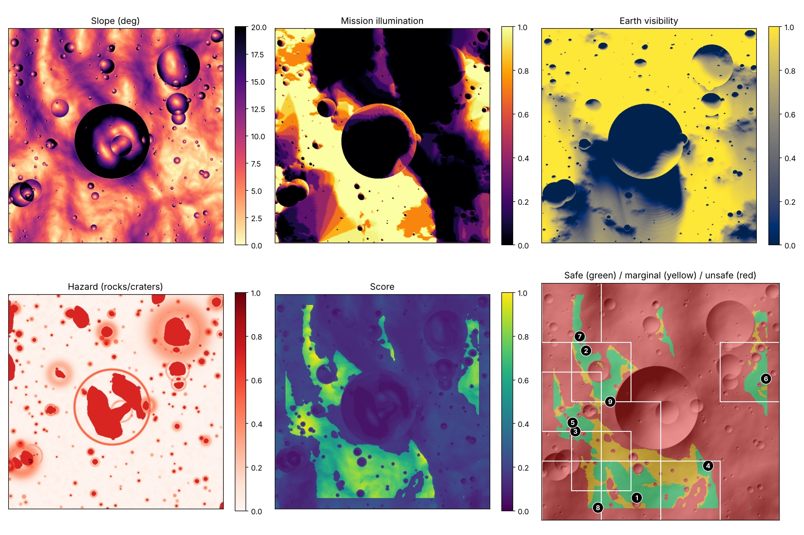

# 🌕 Lunar Landing Site Navigator
### نظام اختيار أفضل مواقع الهبوط على القطب الجنوبي للقمر

يحلل النظام تضاريس القطب الجنوبي للقمر بنفس الفكرة اللي استخدمتها ناسا في اختيار مناطق Artemis III، ويطلع ترتيب لأفضل مناطق الهبوط على خريطة تفاعلية:
🟩 آمن · 🟨 متوسط · 🟥 خطر · 🟦 ظل دائم (جليد ماء محتمل)



📘 **الدليل الكامل بالعربي (من الألف إلى الياء):** [`docs/guide/Lunar_Navigator_Guide_AR.pdf`](docs/guide/Lunar_Navigator_Guide_AR.pdf)

☁️ **التشغيل على سيرفرات GitHub:** تبويب Actions ← Lunar Landing Navigator ← Run workflow، وبعدها نزّل ملف `landing-sites` من نتيجة التشغيل.

---

## التشغيل السريع

```bash
pip install -r requirements.txt
python -m lunar_nav --demo          # يشتغل على بيانات تجريبية مولّدة
# افتح output/landing_sites_map.html بالمتصفح
```

يشتغل على البيانات التجريبية في حوالي 30 ثانية، والخريطة تشتغل بدون إنترنت.

## على بيانات ناسا الحقيقية

```bash
python scripts/download_nasa_data.py --list        # يعرض روابط المصادر الرسمية
python scripts/download_nasa_data.py <رابط-الملف> -o data/
python -m lunar_nav --dem data/<DEM>.tif --pixel-size 20 --downsample 4 \
        [--rocks data/<diviner_rock_abundance>.tif] \
        [--illum data/<lola_avg_illumination>.tif]
```

| خيار | الوظيفة |
|---|---|
| `--pixel-size` | دقة البكسل بالمتر (مو لازم لو الملف GeoTIFF ومثبت `rasterio`) |
| `--dem-scale` | معامل التحويل لمتر (ملفات LOLA IMG فيها SCALING_FACTOR) |
| `--downsample` | يصغّر الملفات الكبيرة عشان يكون الحساب أسرع |
| `--pole ROW COL` | مكان القطب في الصورة (الافتراضي: المنتصف) |
| `--rocks` | خريطة الصخور من Diviner |
| `--illum` | خريطة إضاءة جاهزة من ناسا بدل الحساب |
| `--yolo-weights` + `--yolo-image` | كشف الحفر والصخور بـ YOLO على صور LROC |
| `--weights '{"slope":0.4}'` | تغيير وزن أي معيار |
| `--max-slope 8` | تغيير حد الميلان |
| `--mission-start 120` | يوم بداية المهمة (الافتراضي يختار أفضل نافذة) |

## كيف يشتغل

| الخطوة | الملف | اللي يسويه | يقابل عند ناسا |
|---|---|---|---|
| 1 | `terrain.py` | الميلان والخشونة من خريطة الارتفاع | ليزر LOLA |
| 2 | `illumination.py` | يحسب الأفق في 32 اتجاه (مع انحناء القمر)، ويحرّك الشمس والأرض في السماء، ويحسب نسبة الإضاءة ورؤية الأرض خلال المهمة (6.5 يوم) وعلى مدار السنة | خرائط الإضاءة من LOLA |
| 3 | `illumination.py` | الأماكن اللي متوسط إضاءتها السنوي تحت 0.5% تنحسب ظل دائم (PSR)، ونحسب المسافة لها | الحفر المظلمة اللي فيها جليد |
| 4 | `hazards.py` | يكشف الحفر من التضاريس، ويضيف الصخور (Diviner)، وفيه YOLO اختياري | Diviner + كاميرات LROC |
| 5 | `scoring.py` | يعطي كل معيار نقاط من 0 إلى 1 ويجمعها بأوزان، ويصنّف أخضر/أصفر/أحمر | |
| 6 | `regions.py` | يقسم الخريطة لمناطق 15×15 كم، ويختار 13 مرشحة، وبعدها أفضل 9، مع أفضل نقطة هبوط في كل منطقة | 13 ← 9 منطقة |
| 7 | `viz.py` | خريطة تفاعلية (Leaflet) وصورة ملخص | |

### الشروط (`config.py`)
- **أحمر (ممنوع):** الميلان فوق 10°، أو ظل دائم، أو إضاءة المهمة أقل من 30%، أو صخور كثيرة. ونطبقها على دائرة نصف قطرها 300 م حول كل نقطة، لأن المركبة تحتاج المنطقة كلها آمنة.
- **أصفر:** الميلان بين 8° و 10°، أو رؤية الأرض أقل من 30%، أو النقاط الكلية ضعيفة.
- **الأوزان الافتراضية:** الميلان 30%، الإضاءة 25%، رؤية الأرض 15%، القرب من الظل الدائم 15%، الصخور 15%.
- أطراف الخريطة (3 كم) ما تنحسب، لأن الأفق اللي وراها مو معروف.

## المخرجات (`output/`)
- `landing_sites_map.html`: الخريطة التفاعلية
- `summary.png`: لوحة ملخص فيها كل الطبقات
- `ranked_regions.csv` / `.json`: ترتيب المناطق مع الإحداثيات (خط العرض والطول)
- `layers.npz`: كل الطبقات كمصفوفات لو تبغى تحللها بنفسك

## YOLO
الكود جاهز في `hazards.detect_hazards_yolo`. يحتاج `pip install ultralytics` وملف أوزان مدرّب على صور حفر وصخور من LROC NAC، مثل [قاعدة حفر Robbins](https://doi.org/10.1029/2018JE005592) أو بيانات تعلّمها بنفسك. بدونه، النظام يستخدم كاشف حفر من التضاريس.

## حدود النموذج
- النسخة الحالية تقريب تعليمي، مو أداة طيران معتمدة.
- حساب الإضاءة مبسّط: يعامل الشمس كقرص بخط مستقيم، والأفق عنده 32 اتجاه فقط، وزاوية الشمس تقريبية للمواقع القريبة من القطب (حوالي 5° حوله).
- البيانات التجريبية مولّدة عشوائيًا. الأرقام الحقيقية تطلع بس مع بيانات LOLA.

## الاختبارات
```bash
python -m pytest -q
```

## المصادر
- [NASA SVS – South Pole illumination](https://svs.gsfc.nasa.gov/vis/a000000/a003500/a003587/script_9206_00.html)
- [NTRS 20250011660](https://ntrs.nasa.gov/citations/20250011660)
- [Aerospace America – The Choice](https://aerospaceamerica.aiaa.org/features/the-choice/)
- [arXiv 2406.19863](https://arxiv.org/pdf/2406.19863)
- Mazarico et al. (2011), *Illumination conditions of the lunar polar regions using LOLA topography*, Icarus 211.
