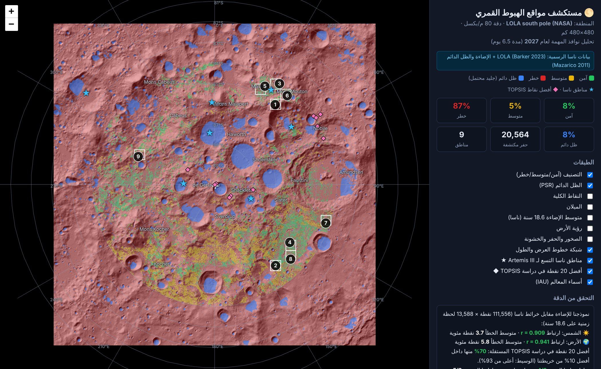
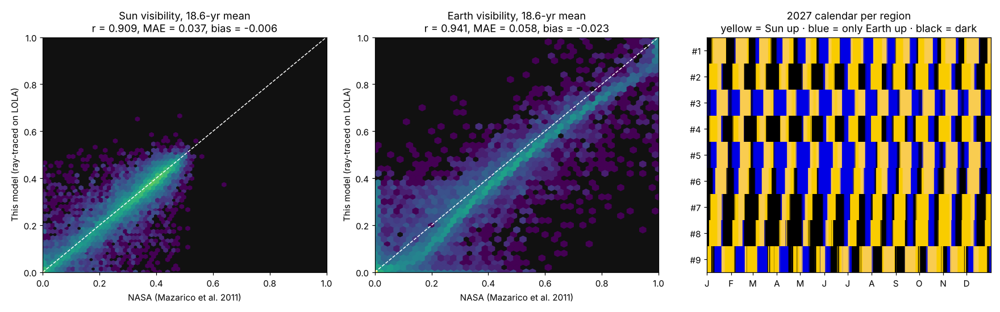

# 🌕 Lunar Landing Site Navigator
### نظام اختيار أفضل مواقع الهبوط على القطب الجنوبي للقمر

يحلل النظام تضاريس القطب الجنوبي للقمر بنفس الفكرة اللي استخدمتها ناسا في اختيار مناطق Artemis III، ويطلع ترتيب لأفضل مناطق الهبوط على خريطة تفاعلية:
🟩 آمن · 🟨 متوسط · 🟥 خطر · 🟦 ظل دائم (جليد ماء محتمل)



📘 **الدليل الكامل بالعربي (من الألف إلى الياء):** [`docs/guide/Lunar_Navigator_Guide_AR.pdf`](docs/guide/Lunar_Navigator_Guide_AR.pdf)

☁️ **التشغيل على سيرفرات GitHub:** كل push يشغّل الاختبارات والتحليل الكامل على بيانات ناسا تلقائيًا. أو من Actions ← Lunar Landing Navigator ← Run workflow (الأوضاع: nasa / demo / custom)، ونزّل ملف `landing-sites-nasa` من نتيجة التشغيل.

---

## التشغيل على بيانات ناسا الرسمية (الوضع الرئيسي)

```bash
pip install -r requirements.txt
python -m lunar_nav --nasa -o output     # ينزّل ~1.2 GB أول مرة، والتحليل ~2.5 دقيقة
```

يستخدم: خرائط LOLA (Barker 2023) للارتفاع والميلان والخشونة، وخرائط الإضاءة ورؤية الأرض والظل الدائم الرسمية (Mazarico 2011)، ومواقع الشمس والأرض الحقيقية لنوافذ الإطلاق في 2027.

### النتائج ([`results/nasa_2027/`](results/nasa_2027/))

| # | الموقع | نوافذ 2027 مضيئة بالكامل | رؤية الأرض | قريبة من منطقة ناسا |
|---|---|---|---|---|
| 1 | 85.08°S, 37.2°E | 36% | 81% | Mons Mouton / Nobile Rim 1-2 |
| 2 | 85.01°S, 143.0°E | 28% | 33% | — |
| 3 | 84.11°S, 32.7°E | 26% | 83% | Mons Mouton |
| … | | | | ([الجدول كامل](results/nasa_2027/REPORT.md)) |

### التحقق من الدقة
- **نموذج الإضاءة مقابل خرائط ناسا** (111,556 نقطة × 18.6 سنة): الشمس r = 0.91 (خطأ 3.7 نقطة)، الأرض r = 0.94 (خطأ 5.8 نقطة).
- **دراسة TOPSIS مستقلة** (arXiv:2406.19863): 70% من أفضل 20 نقطة عندهم ضمن أفضل 10% من خريطتنا.
- **مناطق ناسا التسع لـ Artemis III**: مناطقنا تغطي 4/9 (و5/9 من المرشحين الـ13). الأسباب في [التقرير](results/nasa_2027/REPORT.md).



## التشغيل التجريبي السريع

```bash
python -m lunar_nav --demo          # بيانات مولّدة، 30 ثانية، للتعلم والعرض
```

## ملف ارتفاعات من اختيارك

```bash
python scripts/download_nasa_data.py --list
python -m lunar_nav --dem data/<DEM>.tif --pixel-size 20 --downsample 4
```

| خيار | الوظيفة |
|---|---|
| `--pixel-size` | دقة البكسل بالمتر (مو لازم لو الملف GeoTIFF ومثبت `rasterio`) |
| `--dem-scale` | معامل التحويل لمتر (ملفات LOLA IMG فيها SCALING_FACTOR) |
| `--downsample` | يصغّر الملفات الكبيرة عشان يكون الحساب أسرع |
| `--pole ROW COL` | مكان القطب في الصورة (الافتراضي: المنتصف) |
| `--rocks` | خريطة الصخور من Diviner |
| `--illum` | خريطة إضاءة جاهزة من ناسا بدل الحساب |
| `--yolo-weights` + `--yolo-image` | كشف الحفر والصخور بـ YOLO على صور LROC |
| `--weights '{"slope":0.4}'` | تغيير وزن أي معيار |
| `--max-slope 8` | تغيير حد الميلان |
| `--mission-start 120` | يوم بداية المهمة (الافتراضي يختار أفضل نافذة) |

## كيف يشتغل

| الخطوة | الملف | اللي يسويه | يقابل عند ناسا |
|---|---|---|---|
| 1 | `terrain.py` | الميلان والخشونة من خريطة الارتفاع | ليزر LOLA |
| 2 | `illumination.py` | يحسب الأفق في 32 اتجاه (مع انحناء القمر)، ويحرّك الشمس والأرض في السماء، ويحسب نسبة الإضاءة ورؤية الأرض خلال المهمة (6.5 يوم) وعلى مدار السنة | خرائط الإضاءة من LOLA |
| 3 | `illumination.py` | الأماكن اللي متوسط إضاءتها السنوي تحت 0.5% تنحسب ظل دائم (PSR)، ونحسب المسافة لها | الحفر المظلمة اللي فيها جليد |
| 4 | `hazards.py` | يكشف الحفر من التضاريس، ويضيف الصخور (Diviner)، وفيه YOLO اختياري | Diviner + كاميرات LROC |
| 5 | `scoring.py` | يعطي كل معيار نقاط من 0 إلى 1 ويجمعها بأوزان، ويصنّف أخضر/أصفر/أحمر | |
| 6 | `regions.py` | يقسم الخريطة لمناطق 15×15 كم، ويختار 13 مرشحة، وبعدها أفضل 9، مع أفضل نقطة هبوط في كل منطقة | 13 ← 9 منطقة |
| 7 | `viz.py` | خريطة تفاعلية (Leaflet) وصورة ملخص | |
| — | `nasa.py` · `nasa_pipeline.py` | تنزيل منتجات ناسا وتركيبها على شبكة واحدة، وتحليل 2027 والتحقق | بيانات PGDA الرسمية |
| — | `ephemeris.py` · `sunmodel.py` | مواقع الشمس والأرض الحقيقية (astropy + IAU 2009) وتتبع الأفق بـ numba | نموذج Mazarico 2011 |
| — | `reference.py` · `report.py` | مناطق ناسا التسع، ونقاط TOPSIS، والتقرير | NTRS 20250011660 · arXiv:2406.19863 |

### الشروط (`config.py`)
- **أحمر (ممنوع):** الميلان فوق 10°، أو ظل دائم، أو إضاءة المهمة أقل من 30%، أو صخور كثيرة. ونطبقها على دائرة نصف قطرها 300 م حول كل نقطة، لأن المركبة تحتاج المنطقة كلها آمنة.
- **أصفر:** الميلان بين 8° و 10°، أو رؤية الأرض أقل من 30%، أو النقاط الكلية ضعيفة.
- **الأوزان الافتراضية:** الميلان 30%، الإضاءة 25%، رؤية الأرض 15%، القرب من الظل الدائم 15%، الصخور 15%.
- أطراف الخريطة (3 كم) ما تنحسب، لأن الأفق اللي وراها مو معروف.

## المخرجات (`output/`)
- `landing_sites_map.html`: الخريطة التفاعلية
- `summary.png`: لوحة ملخص فيها كل الطبقات
- `ranked_regions.csv` / `.json`: ترتيب المناطق مع الإحداثيات (خط العرض والطول)
- `layers.npz`: كل الطبقات كمصفوفات لو تبغى تحللها بنفسك

## YOLO
الكود جاهز في `hazards.detect_hazards_yolo`. يحتاج `pip install ultralytics` وملف أوزان مدرّب على صور حفر وصخور من LROC NAC، مثل [قاعدة حفر Robbins](https://doi.org/10.1029/2018JE005592) أو بيانات تعلّمها بنفسك. بدونه، النظام يستخدم كاشف حفر من التضاريس.

## حدود النموذج
- أداة بحثية وتعليمية، مو أداة طيران معتمدة.
- الصخور الأصغر من ~100 م ما تبين في LOLA (تحتاج صور LROC NAC + YOLO).
- ما يدخل فيها مدار NRHO ومسارات الإطلاق وقيود مركبة HLS اللي تستخدمها ناسا.

## الاختبارات
```bash
python -m pytest -q     # 14 اختبار
```

## المصادر
- [NASA SVS – South Pole illumination](https://svs.gsfc.nasa.gov/vis/a000000/a003500/a003587/script_9206_00.html)
- [NTRS 20250011660](https://ntrs.nasa.gov/citations/20250011660)
- [Aerospace America – The Choice](https://aerospaceamerica.aiaa.org/features/the-choice/)
- [arXiv 2406.19863](https://arxiv.org/pdf/2406.19863)
- Mazarico et al. (2011), *Illumination conditions of the lunar polar regions using LOLA topography*, Icarus 211 — [PGDA 69](https://pgda.gsfc.nasa.gov/products/69)
- Barker et al. (2023), *A New View of the Lunar South Pole from LOLA* — [PGDA 90](https://pgda.gsfc.nasa.gov/products/90)
- Archinal et al. (2011), IAU WGCCRE 2009 report, Celest. Mech. Dyn. Astr. 109
- IAU/USGS Gazetteer of Planetary Nomenclature
